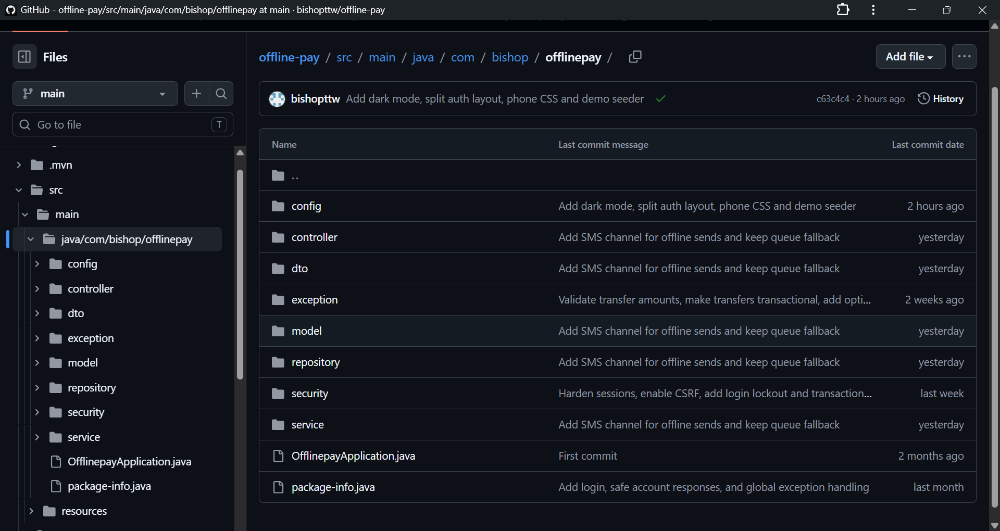
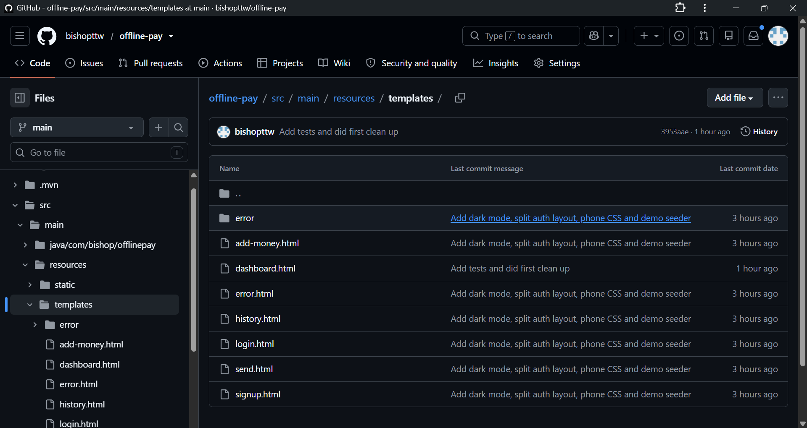
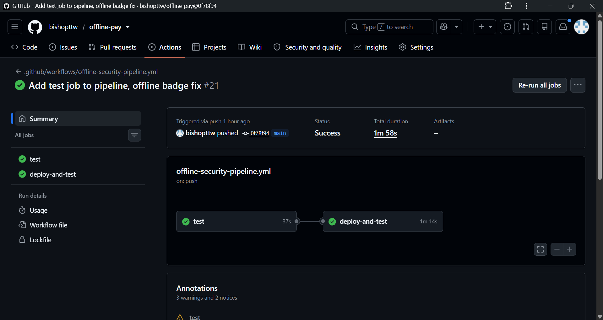
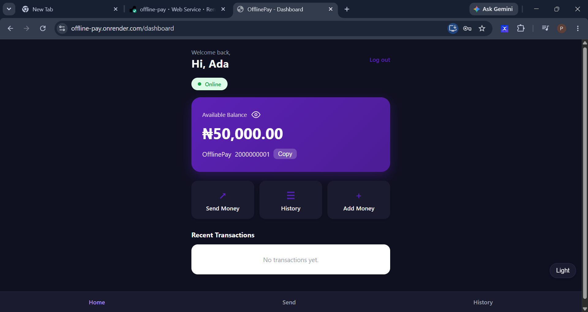
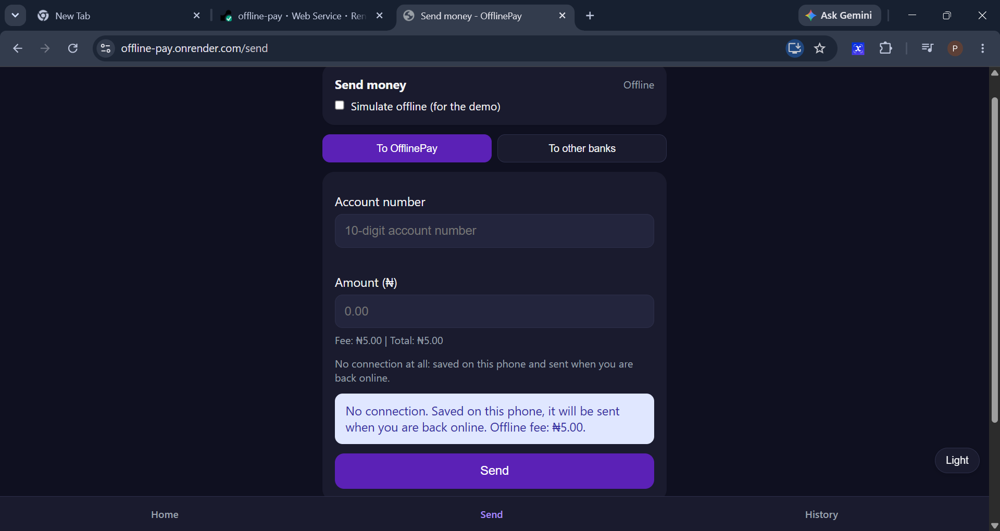

# OfflinePay

**By:** CHUKWUMA PRINCE (NIIT Semester 4, MMS4 project)
**Live demo:** https://offline-pay.onrender.com
**Repository:** https://github.com/bishopttw/offline-pay
**LinkedIn:** https://www.linkedin.com/in/prince-chukwuma-728a91381/?lipi=urn%3Ali%3Apage%3Ad_flagship3_feed%3Baxc8xv12Qei%2BwRR35LxJgg%3D%3D*

OfflinePay is an offline-first wallet and banking simulation. It lets a user keep sending money when the internet is weak or gone, and makes sure every transfer is applied safely once the connection returns.

## The problem it solves

Mobile banking apps fail the moment the connection drops. OfflinePay is built around that case. The app opens with no internet, shows the last known balance, and still lets the user send money in two ways:

1. **SMS/USSD channel (simulated):** the phone has no data, but the "offline" switch is on. The transfer goes through a simulated SMS channel, the receiver is credited immediately, and a higher fee applies (₦5).
2. **Saved on the phone:** there is no connection at all. The transfer is saved on the device. When the connection returns, the user enters their PIN once and every waiting transfer is sent.

Normal online transfers cost ₦1.

## Features

- Sign up and log in with a unique 10-digit account number and a unique Nigerian phone number
- Wallet balance with a hide/show eye
- Add money through Paystack (test mode)
- Send money by account number. The receiver's name is shown masked (for example "John D.") before sending
- Transaction PIN (4 digits) required for every transfer
- Transaction history with statuses: CONFIRMED, PENDING_SYNC, FAILED
- Works offline as an installable app (PWA): add it to the phone's home screen
- Live Online/Offline badge
- Dark and light mode
- Friendly 404 and 500 pages
- Responsive design for phones and laptops

## Security

- Passwords and PINs stored hashed with BCrypt, never as plain text
- Strong password rules and a weak-PIN check (rejects 1111, 1234 and similar)
- Account lock for 5 minutes after 5 wrong attempts (passwords and PINs share one counter)
- Generic login error message, so attackers can't tell which part was wrong
- CSRF protection on all forms and requests (the webhook is the only exception, and it is signature-checked)
- Session cookie is HttpOnly, SameSite and Secure on the live site
- Session ID is changed at login (prevents session fixation) and sessions expire after 10 idle minutes
- Duplicate-send protection: each transfer carries a unique reference, so a retry can't pay twice
- Ownership checks on the server: the sender is always taken from the session, never from the request
- Optimistic locking (`@Version`) on accounts to stop double spending
- Paystack webhook verified with HMAC-SHA512, and payments are verified with Paystack before any money is credited, and credited only once
- Error details hidden from users; H2 console off unless switched on
- Secrets only in environment variables, never in the code or GitHub

## Tech stack

Java 17, Spring Boot 4, Spring Security, Spring Data JPA (Hibernate), H2 database, Thymeleaf, vanilla JavaScript, Paystack (test mode), Docker, GitHub Actions, Render, Kubernetes manifests.

## Run it locally

Requirements: JDK 17 or newer.

```bash
git clone https://github.com/bishopttw/offline-pay.git
cd offline-pay
```

Set your Paystack **test** secret key (never commit it), then start the app.

Windows PowerShell:
```powershell
$env:PAYSTACK_SECRET_KEY="sk_test_xxxxxxxx"
.\mvnw spring-boot:run
```

Mac/Linux:
```bash
export PAYSTACK_SECRET_KEY=sk_test_xxxxxxxx
./mvnw spring-boot:run
```

Open http://localhost:8080.

| Setting | Meaning |
|---|---|
| `PAYSTACK_SECRET_KEY` | Paystack test secret key |
| `APP_BASE_URL` | Public address of the app (used for the Paystack return) |
| `COOKIE_SECURE` | `true` on HTTPS sites |
| `SEED_DEMO` | `true` creates the two demo accounts when the database is empty |
| `H2_CONSOLE` | `true` turns on the H2 console (development only) |

## Demo accounts

Switch on `SEED_DEMO=true` to get these (demo data only):

| Name | Email | Account no. | Password | PIN | Start balance |
|---|---|---|---|---|---|
| Ada Okoro | ada@demo.com | 2000000001 | Demo@12345 | 4829 | ₦50,000 |
| Tunde Bello | tunde@demo.com | 2000000002 | Demo@12345 | 4829 | ₦20,000 |

## Tests

```bash
./mvnw test
```

22 tests cover: signup and login rules, account lockout, online and offline transfers, sync (success and failure), duplicate-send protection, PIN checks, and the Paystack webhook signature. They use an in-memory database, so they never touch real data.

## CI/CD

GitHub Actions runs on every push to `main`:
1. **test:** builds the project and runs all tests
2. **deploy-and-test:** starts a Minikube cluster, creates a Kubernetes secret, applies the RBAC rules, deploys the secure pod and checks its logs. It only runs if the tests pass.

The live site is deployed on Render.

## Docker

```bash
docker compose up --build
```
This starts two instances (agents) of the app for the demo. Pass the Paystack key through the environment, never in the compose file.

## Screenshots

| Screen | Image |
|---|---|
| Backend root |  |
| Frontend root |  |
| GitHub Actions |  |
| Dashboard |  |
| Offline send |  |

## Known limitations (honest notes)

- The SMS/USSD channel is a **simulation** inside the app. It does not connect to a real telecom network.
- Payments use Paystack **test mode**, so no real money moves.
- The database is H2. On Render's free plan it is wiped when the app restarts, which is why the demo accounts are seeded. A real deployment would use PostgreSQL.
- Render's free plan sleeps when idle, so the first load can take up to a minute.
- Sessions expire after 10 idle minutes by design. Waiting offline transfers stay on the phone and are not lost.
- On iPhones, Paystack's return to an installed home-screen app can lose the login. Use Safari for Add Money.
